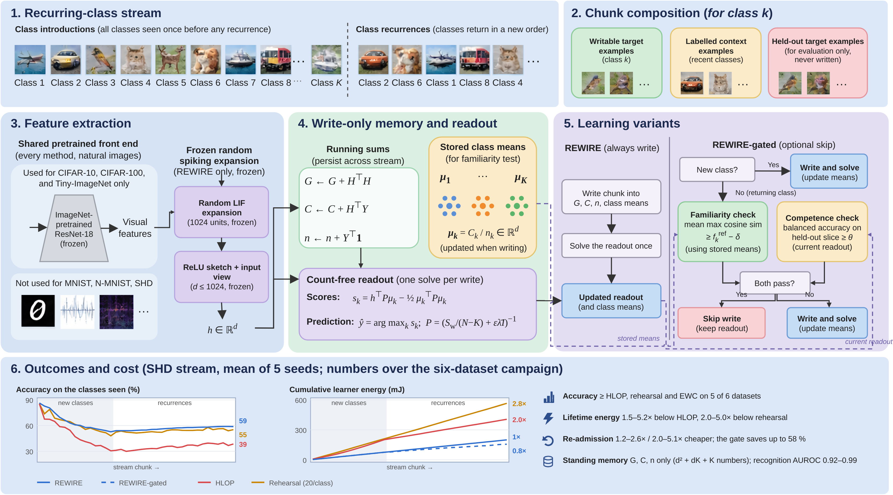
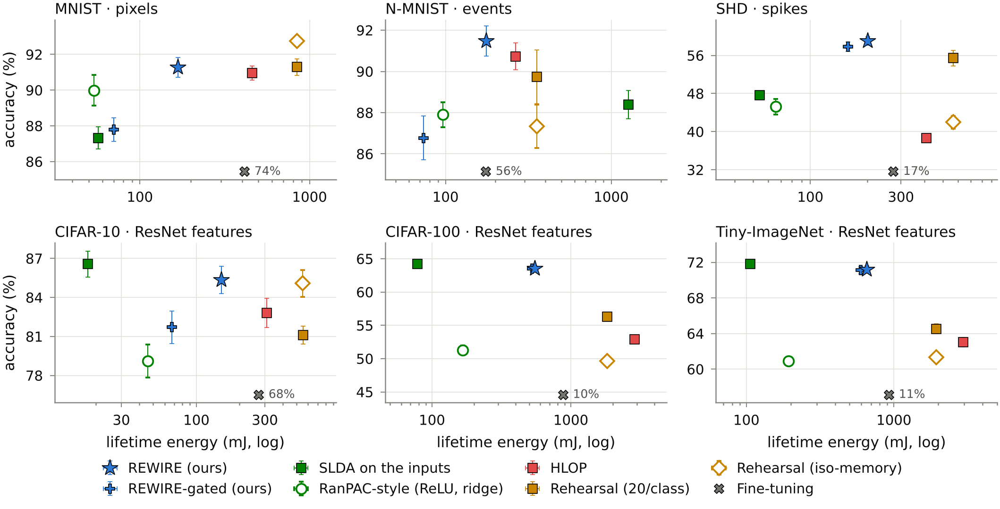
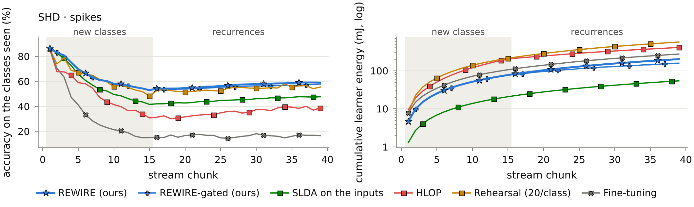

# REWIRE: Write-Only Continual Learning for Recurring Classes in Spiking Neural Networks

Code, per-run records, figures and tables for the NICE 2027 submission *REWIRE: Write-Only Continual Learning for Recurring
Classes in Spiking Neural Networks* (Aftab Hussain and Alois Ferscha, Institute of Pervasive Computing, Johannes Kepler
University Linz).

REWIRE is a continual learner whose only learning operation is a **write**. A frozen random spiking (LIF) expansion feeds a
dual-view sketch into an analytic memory held as three running sums `(G, C, n)`, and the readout is solved in closed form once
per written chunk. Nothing is trained by gradient descent and nothing needs a backward pass. The memory is order-invariant
(interference is impossible, keeping a class costs nothing), its discriminant carries no class counts (repetition cannot bias
it), and a recognition gate decides whether a returning class is written or merely probed.



## Highlights

Class-incremental learning with repetition on six datasets (MNIST, N-MNIST, SHD, CIFAR-10, CIFAR-100, Tiny-ImageNet),
29 learners, 5 seeds, one front end, one width and one energy model (4.6 pJ/MAC, 0.9 pJ/SOP at 45 nm, operation count):

* accuracy matches or exceeds gradient-based spiking continual learning (HLOP, rehearsal, EWC) on five of six datasets, with
  leads of 3.6 (SHD) to 7.2 points (CIFAR-100) on the spike and 80-class streams;
* lifetime energy 1.5–5.2× below HLOP and 2.0–5.0× below rehearsal; a re-admission 1.2–2.6× and 2.0–5.1× cheaper;
* retention at re-admission is flat: nothing has to be relearned when a class returns (Proposition 1);
* the count-free readout is what makes repetition harmless: it gains 1.5–10.4 points over the ridge readout of the earlier
  configuration and is not moved by how often a class is written (Proposition 2);
* the recognition gate saves up to 58 % of lifetime energy on the 8-class streams and recognises returning classes with
  AUROC 0.92–0.99 on five datasets;
* on pretrained 512-d features, streaming LDA on the feature matches REWIRE at 0.12–0.16× the energy: the spiking expansion
  earns its place on pixels, events and spikes, the inputs neuromorphic hardware receives.

Main table (ACC in points, mean ± s.d. over 5 seeds; `plotting/assets/tables/main_body.tex` has BWT and the cost rows):

| Dataset | REWIRE | REWIRE-gated | SLDA-in | RanPAC | HLOP | Rehearsal | Reh.-iso | EWC | Fine-tuning |
|---|---|---|---|---|---|---|---|---|---|
| MNIST | 91.3 ± 1.2 | 87.8 ± 1.5 | 87.3 ± 1.4 | 90.0 ± 1.9 | 91.0 ± 0.9 | 91.3 ± 1.1 | **92.7 ± 0.7** | 74.1 ± 5.7 | 73.7 ± 5.4 |
| N-MNIST | **91.5 ± 1.6** | 86.8 ± 2.4 | 88.4 ± 1.5 | 87.9 ± 1.4 | 90.7 ± 1.5 | 89.7 ± 2.9 | 87.3 ± 2.3 | 55.8 ± 11.6 | 55.8 ± 11.4 |
| SHD | **59.0 ± 2.0** | 57.8 ± 2.2 | 47.7 ± 1.7 | 45.2 ± 3.6 | 38.7 ± 1.5 | 55.4 ± 3.7 | 42.0 ± 3.0 | 16.9 ± 2.0 | 16.5 ± 2.5 |
| CIFAR-10 | 85.3 ± 2.4 | 81.7 ± 2.8 | **86.6 ± 2.2** | 79.1 ± 2.9 | 82.8 ± 2.5 | 81.1 ± 1.5 | 85.1 ± 2.3 | 68.4 ± 3.8 | 68.4 ± 3.9 |
| CIFAR-100 | 63.5 ± 1.0 | 63.5 ± 1.0 | **64.2 ± 0.9** | 51.3 ± 1.5 | 52.9 ± 1.2 | 56.3 ± 1.4 | 49.6 ± 1.3 | 9.7 ± 2.3 | 9.6 ± 2.3 |
| Tiny-ImageNet | 71.2 ± 0.9 | 71.1 ± 0.9 | **71.8 ± 0.9** | 60.9 ± 0.5 | 63.0 ± 1.2 | 64.5 ± 1.3 | 61.3 ± 0.8 | 11.2 ± 1.4 | 11.2 ± 1.5 |
| lifetime energy (mJ, mean) | 317 | 248 | 264 | 104 | 1211 | 1013 | 1012 | 564 | 490 |
| re-admission (mJ, mean) | 5.6 | 2.5 | 7.8 | 2.0 | 11.6 | 18.7 | 18.7 | 10.4 | 9.0 |

The three costs per chunk (mJ, mean over datasets): admission / maintenance overhead / re-admission are 5.6 / 0 / 5.6 for
REWIRE, 5.6 / 0 / 2.5 for REWIRE-gated (68 % of recurrences skipped), 20.7 / 11.7 / 11.6 for HLOP and 17.8 / 8.8 / 18.7 for
rehearsal. Every number above is computed from the released records in `results/campaign_2026-10-09_1120/`.

| | |
|---|---|
|  |  |

## Easy to reproduce: for the research community, new researchers and educational use

Everything is plain PyTorch and NumPy, one package (`rewire/`), one configuration file (`rewire/configure.py`) and a
handful of scripts. The checks run on a laptop CPU in minutes, one dataset runs on a free Colab or Kaggle GPU, and the whole
campaign of the paper runs unattended on one GPU box in an afternoon. Nothing is hidden behind a framework: every learner is
a class behind one interface in `rewire/models/arms.py`, and the stream generator, the cost meter and the metrics are each one
file.

### Quick start (three commands, no data needed)

```bash
git clone https://github.com/Aftab-Hussain302/REWIRE-Write-Only-Continual-Learning-for-Recurring-Classes-in-Spiking-Neural-Networks.git
cd REWIRE-Write-Only-Continual-Learning-for-Recurring-Classes-in-Spiking-Neural-Networks
pip install -r requirements.txt                 # PyTorch, torchvision, NumPy, pandas, scikit-learn, matplotlib, h5py, pytest
python3 -m rewire.preflight                     # the properties the method relies on (Propositions 1 and 2, the solver, the gate)
python3 -m pytest tests -q                      # the same properties as tests
python3 selftest.py                             # every learner of the paper end to end on a short synthetic stream (about five minutes)
```

`REWIRE_PREFLIGHT_CPU=1 python3 -m rewire.preflight` forces the CPU on a machine without a GPU.

### Google Colab and Kaggle

`notebooks/REWIRE_quickstart_colab.ipynb` runs the checks and a real MNIST stream (REWIRE, REWIRE-gated, HLOP, rehearsal)
on a free GPU runtime in about fifteen minutes. The free runtimes are enough for MNIST, N-MNIST, SHD, CIFAR-10 and CIFAR-100
one dataset at a time. **Tiny-ImageNet needs more RAM** than a free runtime usually provides, because the loader keeps the
100 000 training images (64 × 64 pixels, 1.2 GB) in memory while the frozen ResNet-18 extracts their features: run the smaller
streams there, or reduce the per-class sample count (`--set n_train_per_class=200 n_test_per_class=50`), or use a high-RAM
runtime.

### Datasets

The datasets are not bundled. **If you do not download them by hand, `scripts/prepare_data.py` downloads what is missing
automatically** (torchvision for MNIST and CIFAR, `scripts/download_data.py` for N-MNIST, SHD and Tiny-ImageNet) into the
layout the loaders expect. This is the slow path, because the public servers deliver 0.2–1.1 GB archives at modest speed, so a
manual download beforehand saves time but is never required.

| dataset | what the learners receive | official source | folder under `--data_root` |
|---|---|---|---|
| MNIST | 28 × 28 pixels | http://yann.lecun.com/exdb/mnist/ (torchvision) | `MNIST/raw/` |
| N-MNIST | 2 × 34 × 34 event frames, T = 6 | https://www.garrickorchard.com/datasets/n-mnist (`Train.zip`) | `nmnist/Train/<digit>/*.bin` |
| SHD | 700-channel spike trains, T = 20 | https://zenkelab.org/datasets/ (`shd_train.h5.gz`) | `shd/shd_train.h5` |
| CIFAR-10 | frozen ResNet-18 features (512-d) | https://www.cs.toronto.edu/~kriz/cifar.html (torchvision) | `cifar-10-batches-py/` |
| CIFAR-100 | frozen ResNet-18 features (512-d) | https://www.cs.toronto.edu/~kriz/cifar.html (torchvision) | `cifar-100-python/` |
| Tiny-ImageNet | frozen ResNet-18 features (512-d) | http://cs231n.stanford.edu/tiny-imagenet-200.zip | `tiny-imagenet-200/` |

```bash
python3 scripts/prepare_data.py --data_root ~/data                        # checks, downloads what is missing, builds the feature caches
python3 scripts/prepare_data.py --data_root ~/data --datasets mnist shd   # a subset
```

The ImageNet-pretrained ResNet-18 (torchvision `IMAGENET1K_V1`) is downloaded on first use; its features are extracted once per
dataset and cached under the data root. `DATASETS.md` has the details.

### Hardware and GPU setup

* The campaign of the paper ran on one **NVIDIA RTX A6000** (48 GB), 6 CPU cores, Ubuntu, Python 3.12, PyTorch 2.14 + CUDA 12.6,
  in about seven hours (`results/campaign_2026-10-09_1120/ENVIRONMENT.md` records the machine and the exact package versions).
  The gradient baselines are the expensive part; REWIRE itself needs one forward pass and one 1024 × 1024 solve per chunk.
* `bash setup_env.sh` creates a virtual environment with a CUDA build of PyTorch on a fresh Ubuntu box with an NVIDIA driver;
  `pip install -r requirements.txt` is enough anywhere PyTorch is already installed.
* A GPU with 8 GB is plenty; the checks and the single-dataset runs also work on CPU, only slower.

### Reproduce the paper

```bash
python3 scripts/run_all.py --data_root ~/data --smoke               # ten minutes: every dataset and stage on short streams, one seed
python3 scripts/run_all.py --data_root ~/data                       # the campaign: 6 datasets x 29 learners x 5 seeds + both sweeps + fidelity
python3 scripts/run_all.py --resume results/results_<date>_<time>   # continues an interrupted run; finished units are never repeated
```

The run folder then holds `rows.json` per dataset and sweep (every run with its full configuration, stream schedule, per-chunk
accuracy and energy curves and visit log), the per-dataset figures and tables, the paired and pooled tests and `MANIFEST.json`
with the SHA-256 of every source file. `REPRODUCE.md` walks through every step. One dataset in one process, for inspection:

```bash
python3 run_campaign.py --datasets shd --seeds 0 --arms rewire rewire_gated hlop replay --no-sweeps --data_root ~/data --out results/dev
```

### The paper's tables and figures from the released records (no training)

```bash
python3 scripts/unpack_records.py results/campaign_2026-10-09_1120
python3 plotting/make_plots.py --run results/campaign_2026-10-09_1120 --out plotting/assets_rebuilt
```

This re-derives every table (`tables/*.tex`), every figure (`figs/*`), the 2 111 numbers the text quotes (`macros.tex`,
`numbers.json`) and the hypothesis summary (`summary.md`) from the records. `plotting/assets/` holds the copy used for the
submission; the rebuilt tables are identical to it.

### Notation: the paper's symbols in the code

| paper | meaning | code |
|---|---|---|
| $H$, $T$, $\beta$, $u_{\rm th}$ | LIF units, time steps, leak, firing threshold (Eq. 5) | `rw_hidden`, `T`, `beta`, `thr` in `rewire/configure.py` |
| $z(x)$, $r(x)$, $d_s$ | firing rates of the expansion, ReLU sketch, sketch width (Eq. 6) | `LIFNet.features`, `REWIRE._sketch_view`, `rw_sketch` / `rw2_sketch` |
| $g$, $v(x)$ | gain of the dual view, input view (Eq. 6) | `REWIRE.sk_scale` (set on the calibration batch), `REWIRE._input_view`, `rw_skip_input`, `rw_skip_max` |
| $(G, C, n)$ | the three running sums (Eq. 7) | `RidgeMemory.G`, `.C`, `.n` |
| $\lambda$ | ridge regularisation of REWIRE-v1 (Eq. 8) | `rw_lambda` |
| $\mu_k$, $S_{\rm w}$, $P$, $\varepsilon$ | class means, within-class scatter, precision of the shrunk covariance, shrinkage (Eq. 9) | `RidgeMemory._solve_lda` (`Lam` is $P$), `rw2_eps` (REWIRE) / `rw_lda_eps` (controls) |
| $s_k(h)$ | discriminant scores (Eq. 10) | `RidgeMemory.scores` (`W`, `b`) |
| $f(x)$, $f_{\rm M}(x)$ | cosine and Mahalanobis familiarity (Eq. 11) | `REWIRE._fam` with `rw_fam="cos"` / `"maha"` |
| $f^{\rm ref}_k$, $\bar f_t$, $c_t$ | familiarity reference of class $k$, chunk familiarity, competence (Eq. 12) | `REWIRE.fam_ref[k]`, `fam` and `c_pre` in `REWIRE.visit`, `balanced_acc` |
| $\delta$, $\theta$, $B$ | gate margin, competence threshold, budget (Eq. 12) | `rw_gate_delta`, `theta_hi`, `rw_gate_budget` |
| $E_{\rm MAC}$, $E_{\rm AC}$, backward factor | energy model (Eq. 4) | `pj_mac`, `pj_sop`, `backward_factor` (`CostMeter`) |

## Repository layout

```
rewire/configure.py                every knob: protocol, learners, cost model, presets, per-dataset settings
rewire/models/arms.py              every learner behind one interface, and the registry ARMS (names, groups, labels)
rewire/engine.py                   the stream, the metrics, the recovery and recognition probes
rewire/campaign.py                 main grid, sweeps, reports;    rewire/worker.py   one (dataset, seed, stage) unit of work
rewire/dataloader/                 loaders, the frozen front end, the stream generator;   rewire/modules/   LIF network, cost meter
rewire/baselines/hlop_official/    third-party: HLOP's Hebbian module, unmodified from github.com/pkuxmq/HLOP-SNN (Xiao et al., ICLR 2024, Apache 2.0)
rewire/utils/plotting.py           the per-run figures and summary tables
scripts/prepare_data.py            data check, automatic download, feature caches;   scripts/download_data.py   the official archives
scripts/run_all.py                 the parallel, resumable campaign;   scripts/merge_results.py   joins the units of a run into reports
scripts/unpack_records.py          decompresses the released records
run_campaign.py                    one dataset in one process;   selftest.py, tests/, rewire/preflight.py   the checks
plotting/make_plots.py             the paper's tables, figures and numbers from a run;   plotting/assets/   the submitted copy
results/campaign_2026-10-09_1120/  the released records of the campaign (gzipped rows, summaries, logs, environment, manifest)
notebooks/REWIRE_quickstart_colab.ipynb   the free-GPU walkthrough
```

Learner names: `rewire` is the proposed method, `rewire_gated*` its gate variants (`_b128` budgeted, `_t095` stricter
threshold, `_maha` Mahalanobis familiarity), `rewire_v1` the earlier configuration (sketch only, ridge readout), `abl_*` the
one-factor ablations, `ctrl_*`, `ranpac`, `ridge_input` and `hd_memory` the gradient-free controls, and `hlop*`, `replay*`,
`ewc` and `naive` (fine-tuning) the gradient baselines.

## What changed after the campaign (nothing that affects a number)

`results/campaign_2026-10-09_1120/MANIFEST.json` records the SHA-256 of every source file as it was when the campaign ran.
The learners, the protocol, the metrics and the cost model are unchanged. Three files differ for the release:

* `rewire/utils/plotting.py`: a legend-placement bug that collapsed the panels of the multi-panel figures was fixed; the figures
  are drawn from the saved rows, so nothing was re-run.
* `rewire/dataloader/loaders.py`: one stale docstring sentence corrected (the ResNet-18 front end *is* applied to
  Tiny-ImageNet, as `configure.py` and the paper state). Comment only.
* `scripts/prepare_data.py`: a missing dataset is now downloaded automatically (`--no-download` disables it); the loading,
  caching and reporting are as before.

New for the release: `scripts/download_data.py`, `scripts/unpack_records.py`, `plotting/`, `notebooks/` and `results/`.

## Citation

```bibtex
@inproceedings{hussain2027rewire,
  title     = {{REWIRE}: Write-Only Continual Learning for Recurring Classes in Spiking Neural Networks},
  author    = {Hussain, Aftab and Ferscha, Alois},
  booktitle = {Neuro-Inspired Computational Elements Conference (NICE)},
  year      = {2027},
  note      = {under review}
}
```

The HLOP baseline runs the HLOP authors' own Hebbian module (see License below). If you use it, please also cite Xiao et al.,
"Hebbian Learning based Orthogonal Projection for Continual Learning of Spiking Neural Networks", ICLR 2024
([arXiv:2402.11984](https://arxiv.org/abs/2402.11984); BibTeX in
[`rewire/baselines/hlop_official/README.md`](rewire/baselines/hlop_official/README.md)).

## License

Apache License 2.0 (see `LICENSE`). `rewire/baselines/hlop_official/hlop_module.py` is not our code: it is the HLOP authors'
Hebbian module, taken unmodified from the official repository [pkuxmq/HLOP-SNN](https://github.com/pkuxmq/HLOP-SNN)
([`modules/hlop_module.py` at commit `530b89a`](https://github.com/pkuxmq/HLOP-SNN/blob/530b89aa19ca1b8e31bd43cf3af8db14a229da64/modules/hlop_module.py);
Xiao et al., ICLR 2024) under the Apache License 2.0; its licence, a NOTICE and a provenance
[README](rewire/baselines/hlop_official/README.md) (what is theirs and what is ours) are in that folder. The datasets belong to their authors and are downloaded from their official sources.
